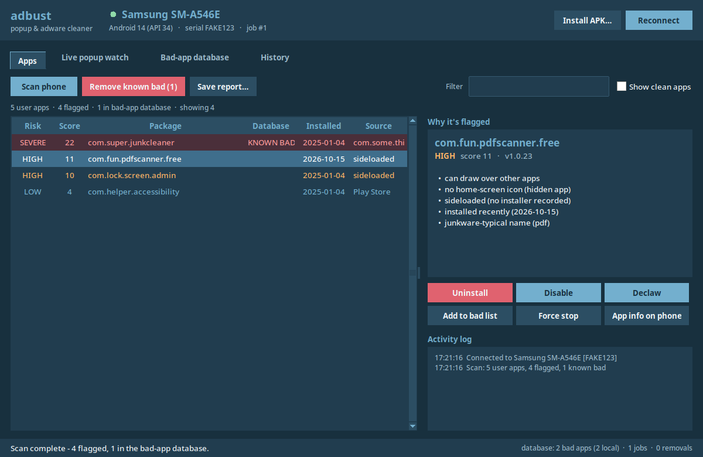
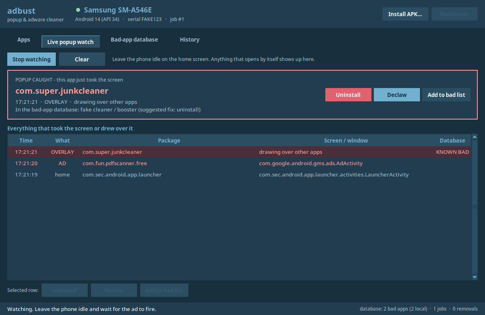

# adbust

Android popup and adware cleaner for a phone-repair bench. Plug the
customer's phone in over USB, and adbust:

- **scans** every user-installed app and scores how able it is to throw
  ads at the customer (overlay permission, accessibility, device admin,
  hidden icon, sideloaded, installed recently, junkware-style name…)
- **watches live**. Leave the phone idle and the app that pops up a
  full-screen ad or draws over the screen names itself, with
  **Uninstall / Declaw / Add to bad list** buttons right there
- **remembers**. Every app you flag goes into a bad-app database. The next
  phone that has it is flagged **SEVERE** at once, and **Remove known bad**
  cleans them all in one click
- logs every job (handset, serial, what was done) so you can look back

One Python file, standard library only, runs on **Windows and Linux**.




## Setup

1. Python 3.8+ with tkinter.
   - Fedora: `sudo dnf install python3-tkinter android-tools`
   - Debian/Ubuntu: `sudo apt install python3-tk android-tools-adb`
   - Windows: the python.org installer (tick *tcl/tk*), plus
     `winget install Google.PlatformTools`, or unzip platform-tools next
     to `adbust.py`
2. On the phone: Settings → About → tap *Build number* 7 times, then
   Developer options → **USB debugging** on. Plug in and tap **Allow**.
3. `python adbust.py` (or double-click it on Windows).

adb is found on `PATH`, next to the script, in `$ANDROID_HOME`, or in the
usual SDK / winget / scoop locations.

## Using it

| Tab | What it's for |
|---|---|
| **Apps** | Scan results, worst first. Select one or more apps → *Uninstall*, *Disable*, *Declaw*, *Force stop*, *App info on phone*, *Add to bad list*. *Remove known bad (N)* applies the database's suggested fix to every known-bad app on the phone. |
| **Live popup watch** | *Start watching*, put the phone down on the home screen, and wait. Every app that takes the screen or draws over it is listed. Ad-SDK screens (AdMob, AppLovin, Unity, IronSource, Facebook…) show as **AD** and overlays as **OVERLAY**. The banner shows the culprit with action buttons. |
| **Bad-app database** | Add, edit and delete entries, *Update from GitHub*, *Import…* and *Export shared list…*. |
| **History** | One row per phone connected, and every action taken on it. |

**Declaw** is the gentle option. It denies overlay, notifications and
background starts, revokes accessibility and notification access, and
force-stops the app, but leaves it and its data installed. **Uninstall**
removes it for the current user. An app that is an active *device admin*
can't be uninstalled until that is switched off, so adbust opens its App
info page on the phone for you.

If nothing is flagged and the ads keep coming, they are almost always
**browser push notifications**. *Save report…* includes the steps to clear
them in Chrome and Samsung Internet.

### Command line

The same engine works without the window:

```
python adbust.py scan                 # score apps
python adbust.py watch                # live-name the popup
python adbust.py fix --report job.txt # interactive per-app triage
python adbust.py clean                # remove every known-bad app found
python adbust.py nuke --threshold 8   # declaw everything scoring 8+
python adbust.py report out.txt
python adbust.py db list | add <pkg> | remove <pkg> | export | import <file> | update
```

## The bad-app database

There are two layers:

- **`badapps.json`** in this repo is the *shared* list. It loads at start-up,
  and *Update from GitHub* fetches the newest copy from
  `https://raw.githubusercontent.com/THVjQ/adbust/main/badapps.json`.
- A **local SQLite file** holds this bench's own additions, how often each
  app was seen and removed, and the job history.
  - Linux: `~/.local/share/adbust/adbust.db`
  - Windows: `%APPDATA%\adbust\adbust.db`
  - Override with `ADBUST_HOME` or `--db`.

To share what you've found, use **Export shared list…** (or
`python adbust.py db export`). That writes `badapps.json`; commit and push
it, or open a pull request. Local edits are never overwritten by an update.

```json
{
  "schema": 1,
  "updated": "2026-10-20",
  "apps": [
    {"pkg": "com.example.junkcleaner", "label": "Super Cleaner",
     "category": "fake cleaner / booster", "action": "uninstall",
     "notes": "full-screen ads after unlock", "added": "2026-10-20",
     "reports": 3}
  ]
}
```

Categories: `adware`, `popup ads`, `fake cleaner / booster`, `malware`,
`stalkerware`, `junk / bloat`, `other`. Actions: `uninstall`, `disable`,
`declaw`.

The shared list starts empty on purpose. Only add apps you actually caught
on a phone. A package name that is wrong in a public list gets someone's
good app removed.

### Future: a server

Sync is a plain HTTP GET of that JSON, so a server only has to serve the
same document. Point benches at it with
`ADBUST_DB_URL=https://your-server/badapps.json`. Uploading reports from the
bench is the next step and isn't built yet.

## Testing

```
python -m unittest discover -s tests -v
```

`tests/fakephone.py` is a fake handset. It swaps out only the adb transport,
so every parser and action runs for real against it, and it keeps state
(an uninstall really removes the app from the next scan).
`tests/test_gui.py` presses **every button** in the window. It fails if a
button is added without a test, and since a disabled button does nothing
when pressed, it also checks each button is enabled only when it should be.
It needs a display; use `xvfb-run` on a headless box.

### Fake-adware test app

`testapp/` builds a harmless APK, `io.github.thvjq.adbusttest.pdfscanner`,
for trying adbust on a real phone. Once opened it shows a red "FAKE AD"
screen every 15 seconds. It has no network permission and collects
nothing.

```
testapp/build.sh                                     # needs the Android SDK + JDK
adb install testapp/build/adbust-test.apk
adb shell appops set io.github.thvjq.adbusttest.pdfscanner SYSTEM_ALERT_WINDOW allow
adb shell monkey -p io.github.thvjq.adbusttest.pdfscanner 1   # open it once
```

Press Home, start **Live popup watch**, and it gets caught as **AD**
within 15 seconds. *Declaw* stops the popups, and *Uninstall* removes it.

## Licence

MIT
